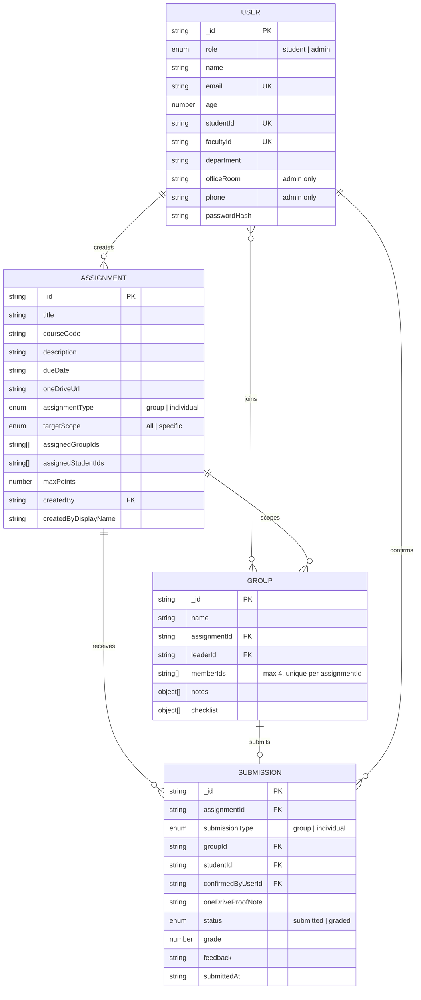

Joineazy — Student, Group & Assignment Management System

A role-based full-stack web application built with **React, Tailwind CSS, Node.js, Express, MongoDB (Mongoose), WebSockets, and Docker**. Students form project groups (strictly capped at 4 members with per-task uniqueness), collaborate in real time, and confirm external OneDrive assignment uploads via two-step verification, while professors manage group/individual assignments, monitor live progress, view analytics, and grade submissions.

---

 1. Overview of Implementation

- **Role-Based Access Control (JWT)**:
  - **Student Role**: Register/sign in, browse eligible assignments (group & individual), open validated OneDrive submission links, create groups, invite/add teammates by Gmail or Student ID (max 4 per group, no student repeated across different groups for the same assignment), post real-time collaboration notes/milestones, confirm submission via two-step verification (`"Yes, I have submitted"` → `"Confirm Final Submission"`), and track personal/group progress bars.
  - **Professor (Admin) Role**: Create, edit, and delete assignments with explicit targeting (**Group** vs **Individual**, **All** vs **Specific Groups/Students**), track group-wise collaboration and student-wise completion rates, view analytics charts and summary KPIs, and grade submissions with written feedback.
- **Privacy & Security Isolation**:
  - Student-facing REST endpoints strictly strip professor personal details (`email`, `age`, `phone`, `officeRoom`, `facultyId`, `passwordHash`) and expose only public assignment metadata and instructor display name.
  - JWTs are held in React memory (`Authorization: Bearer`) rather than `localStorage` or `sessionStorage`, and all Express routes block MongoDB operator injection (`$gt`, `$ne`, dotted keys).
- **Real-Time Collaboration & Monitoring (`/ws`)**:
  - Authenticated WebSocket server attached to the Express HTTP server broadcasts `assignment:updated`, `group:updated`, `submission:updated`, `grade:updated`, and `presence:update` events so professor analytics and student group workspaces update live.

---

 2. Folder Structure

```text
├── backend/
│   ├── app.ts                    / Express app factory & security middleware
│   ├── config/
│   ├── db/
│   │   ├── repository.ts         / Mongoose MongoDB + embedded persistent store fallback
│   │   └── seedData.ts           / Deterministic academic seed data
│   ├── middleware/
│   │   └── auth.ts               /JWT verification, RBAC guards, NoSQL operator blocker
│   ├── models/
│   │   └── schemas.ts            / Mongoose Schemas (User, Assignment, Group, Submission)
│   ├── realtime/
│   │   └── wsServer.ts           /Authenticated WebSocket hub
│   └── routes/
│       ├── analyticsRoutes.ts
│       ├── assignmentRoutes.ts
│       ├── authRoutes.ts
│       ├── groupRoutes.ts
│       ├── studentRoutes.ts
│       └── submissionRoutes.ts
├── src/                          / React + Tailwind CSS Frontend
│   ├── components/
│   │   ├── AuthScreen.tsx
│   │   ├── LayoutShell.tsx
│   │   ├── ProfessorDashboard.tsx
│   │   ├── StudentDashboard.tsx
│   │   └── TwoStepSubmissionModal.tsx
│   ├── context/
│   │   └── AuthContext.tsx
│   ├── shared/
│   │   ├── rules.ts              / Pure domain validation & progress math
│   │   └── rules.test.ts         / Node test suite (node:test)
│   └── types/
│       └── api.ts
├── server.ts                     / Unified HTTP + WebSocket + Vite/Static server
├── Dockerfile
└── docker-compose.yml
```

---

 3. Setup & Run Instructions

 **Local Development**
1. Install dependencies:
   ```bash
   npm install
   ```
2. Configure environment variables (optional for local preview; falls back to an embedded persistent store at `data/joineazy-db.json` if `MONGODB_URI` is unset):
   ```bash
   cp .env.example .env
   # Set MONGODB_URI=mongodb://localhost:27017/joineazy
   ```
3. Run unit tests:
   ```bash
   npx tsx --test src/shared/rules.test.ts
   ```
4. Start the full-stack server (port `3000`):
   ```bash
   npm run dev
   ```

 Docker Compose (App + MongoDB 7)
```bash
docker compose up --build
```
The application will be available at `http://localhost:3000` backed by `mongodb://mongodb:27017/joineazy`.

---

 4. REST API Endpoints

| Method | Endpoint | Role | Description |
| :--- | :--- | :--- | :--- |
| `POST` | `/api/auth/register` | Public | Register Student or Professor (Admin) |
| `POST` | `/api/auth/login` | Public | Authenticate and receive signed JWT |
| `POST` | `/api/auth/demo` | Public | One-click demo account sign-in |
| `GET` | `/api/auth/me` | Auth | Retrieve own profile |
| `GET` | `/api/students/directory` | Auth | Search student IDs/emails for group invites |
| `GET` | `/api/students/progress` | Admin | Student-wise completion rates, ages, grades |
| `GET` | `/api/assignments` | Auth | Role-filtered assignments (strips professor PII for students) |
| `POST` | `/api/assignments` | Admin | Create group/individual assignment (`all` or `specific`) |
| `PUT` | `/api/assignments/:id` | Admin | Edit assignment details or targeting |
| `DELETE` | `/api/assignments/:id` | Admin | Delete assignment and cascade cleanup |
| `GET` | `/api/groups` | Auth | Student's groups or all groups (Admin) |
| `POST` | `/api/groups` | Student | Create group (max 4, unique per task) |
| `POST` | `/api/groups/:id/members` | Student | Invite/add student by email or Student ID |
| `DELETE` | `/api/groups/:id/members/:memberId` | Student | Remove member or leave before submission |
| `POST` | `/api/groups/:id/notes` | Student | Post real-time group collaboration note |
| `PATCH` | `/api/groups/:id/checklist` | Student | Toggle or add collaboration milestone |
| `GET` | `/api/submissions` | Auth | Student's/group's or all submissions (Admin) |
| `POST` | `/api/submissions/confirm` | Student | Two-step verified OneDrive submission confirmation |
| `PATCH` | `/api/submissions/:id/grade` | Admin | Grade submission and save instructor feedback |
| `GET` | `/api/analytics/overview` | Admin | KPIs, per-assignment completion rates, live activity |

---

 5. Database Schema & Entity-Relationship Diagram



---

 6. Architecture Overview

```text
React 19 SPA (Tailwind CSS)
   ├── HTTPS REST (/api/*) with Authorization: Bearer <JWT>
   └── WebSocket (/ws?token=<JWT>)
          │
          ▼
Express + Node HTTP Server (port 3000)
   ├── Auth & RBAC Middleware (JWT + NoSQL operator guard)
   ├── Pure Validation Layer (src/shared/rules.ts)
   ├── Real-Time Hub (wsServer.ts)
   └── Repository Layer (backend/db/repository.ts)
          ├── Primary: MongoDB 7 via Mongoose (MONGODB_URI)
          └── Fallback: Persistent Atomic JSON Store (data/joineazy-db.json)
```

---

 7. Key Design & Deployment Decisions

1. **Dual-Mode Persistence**: Uses real Mongoose schemas and MongoDB queries whenever `MONGODB_URI` is provided (including via `docker-compose.yml`), while transparently falling back to an atomic persistent JSON store in environments without a running `mongod` daemon.
2. **Server-Side Privacy Projection**: Students never receive professor personal attributes (`email`, `age`, `phone`, `officeRoom`, `facultyId`), enforced at the API serialization layer via `stripProfessorPersonalData`.
3. **Shared Pure Business Rules**: Group capacity (`<= 4`), per-assignment student uniqueness, URL scheme sanitization, and progress calculations live in `src/shared/rules.ts` and are unit-tested with `node:test`.
